# Parameterised Asynchronous FIFO

A dual-clock, parameterised FIFO design for the Digilent Basys 3 FPGA board. This repository contains the Verilog RTL, simulation testbenches, Xilinx Vivado project, Clocking Wizard IP configuration, Basys 3 constraints, implementation reports, a previously generated bitstream, and documentation images.

## Repository layout

    README.md                         Complete project and file guide
    LICENSE                           CERN-OHL-P-2.0 license text for covered source
    NOTICE.md                         License scope and third-party asset notices
    .gitignore                        Excludes local Vivado build output
    rtl/                              Four synthesizable Verilog modules
    tb/                               Ten simulation testbenches
    constraints/                      Basys 3 pin and clock constraints
    ip/clk_wiz_0/                     Clocking Wizard configuration
    vivado/                           Vivado project file
    tcl_script/                       Project creation and setup scripts
    bitstream/                        Packaged Basys 3 programming image
    reports/                          Captured Vivado reports
    images/architecture/              Architecture and logic diagrams
    images/timing/                    FIFO and synchronization timing diagrams
    images/vivado/                    Vivado screenshots
    waveforms/                        Simulation screenshots and WCFG views

Each folder contains its own README with a file-by-file description for that folder.

## What this repository delivers

This GitHub-ready folder contains the FIFO source design and the supporting files needed to inspect, simulate, and rebuild the Basys 3 project:

- Synthesizable Verilog RTL in `rtl/`, with behavioral testbenches in `tb/`.
- The portable Vivado project in `vivado/`, Basys 3 pin and timing constraints in `constraints/`, and Clocking Wizard configuration in `ip/`.
- Tcl scripts in `tcl_script/` for setting up the packaged project or creating a fresh project from the canonical sources.
- The previously generated Basys 3 programming image in `bitstream/`.
- Vivado report snapshots in `reports/`, static simulation captures and waveform layouts in `waveforms/`, and explanatory architecture, timing, and Vivado images in `images/`.
- Root and per-folder READMEs describing the design, contents, and use of each area.

The `.bit` file and reports are saved outputs from earlier Vivado runs. They are included as deliverables for reference, but they may not match later source changes; rebuild the project and regenerate reports before treating them as results for a new revision. The reports folder guide explains each report and its limitations.

## What the design does

The FIFO stores words written in one clock domain and makes them available in a separate read clock domain. The core uses binary pointers for memory addressing and Gray-coded pointers for safe transfer of pointer state between clock domains. Each remote Gray pointer passes through a configurable multi-stage synchronizer before it is used to calculate full or empty status.

The default core configuration is DATA_WIDTH=8, FIFO_DEPTH=16, and SYNC_STAGES=2. The Basys 3 wrapper defaults to DATA_WIDTH=12 and FIFO_DEPTH=16. FIFO depth must be a power of two and at least two; data width must be positive; synchronizer stages must be at least two.

### Architecture overview

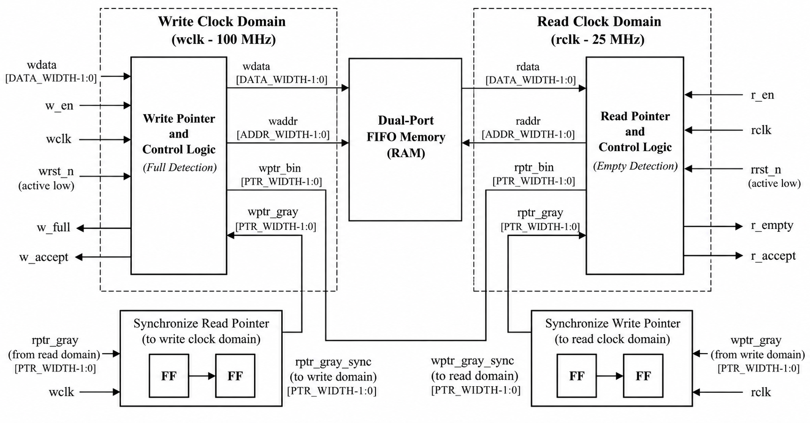

The write side accepts a request only when the FIFO is not full. The read side accepts a request only when the FIFO is not empty. The two sides update their own pointers on their own clocks. Gray coding makes adjacent pointer values differ by one bit, reducing the risk of capturing an incoherent pointer while it crosses a clock boundary.

### Datapath and Basys 3 wrapper

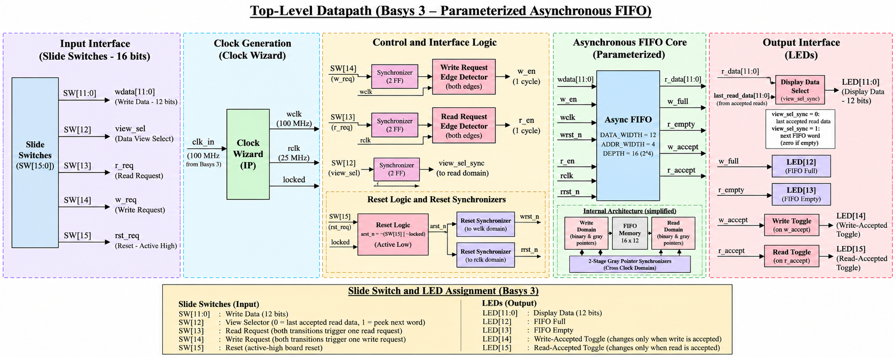

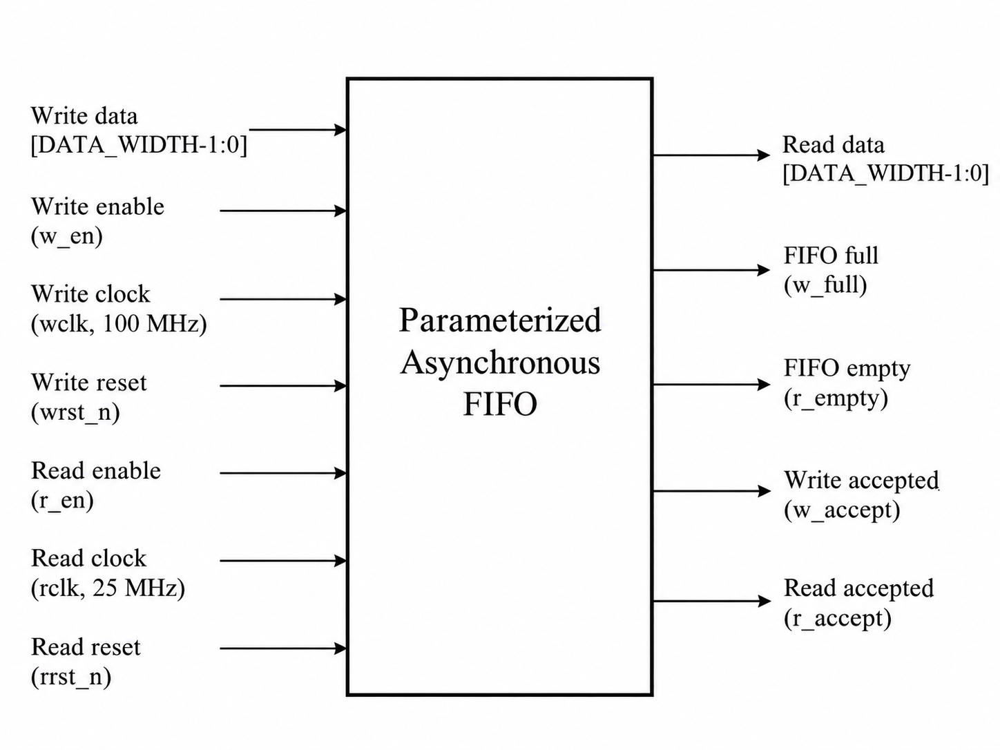

The binary write pointer selects the memory location for an accepted write. The binary read pointer selects the current output word. The read data is combinational and is meaningful when the empty flag is low. The Basys 3 wrapper connects the FIFO to board switches, LEDs, reset logic, and the Clocking Wizard.

### Clock-domain crossing

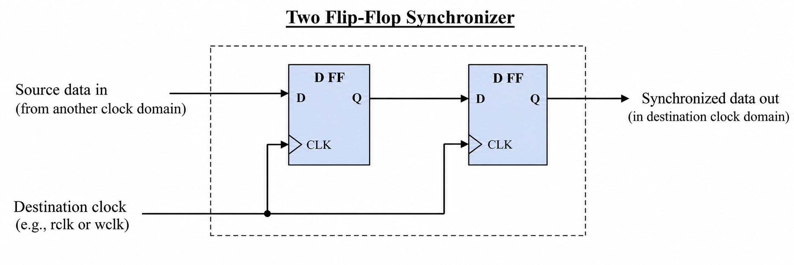

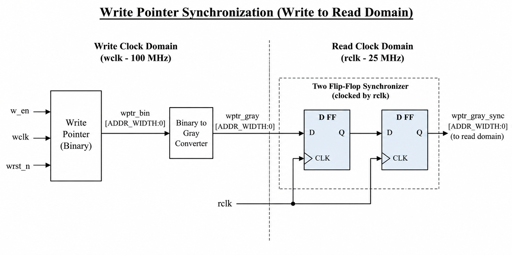

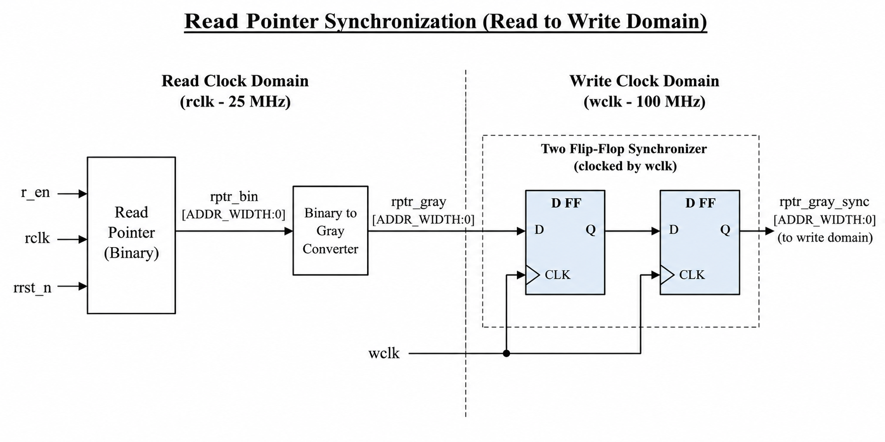

The FIFO synchronizes the read Gray pointer into the write domain and the write Gray pointer into the read domain. The reset synchronizers separately release reset in each clock domain.

### Full and empty detection

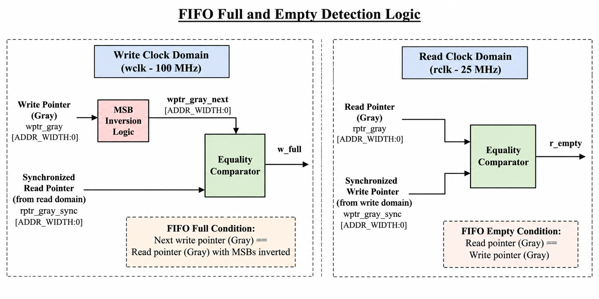

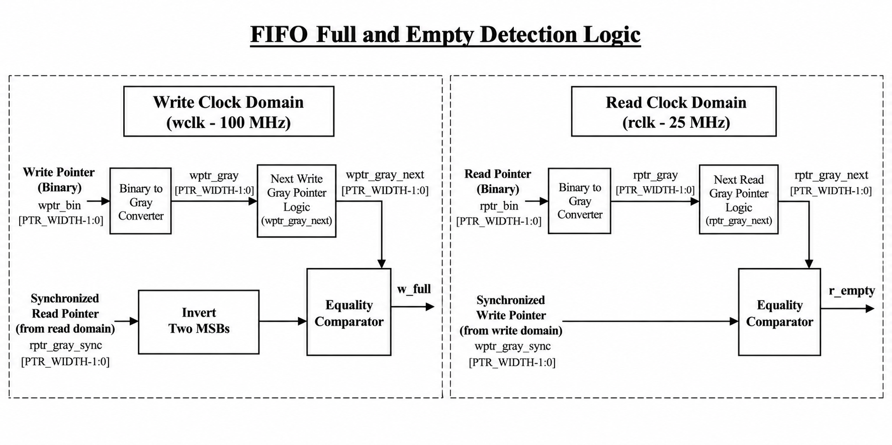

The write side declares full when the next write Gray pointer matches the synchronized read pointer with its two most significant bits inverted. The read side declares empty when the next read Gray pointer matches the synchronized write pointer.

### Synchronization timing reference

These three diagrams cover metastability, multi-stage synchronization, and asynchronous FIFO operation. They are cropped from the cited FIFO reference; descriptions and source attribution are in [images/timing/README.md](images/timing/README.md).

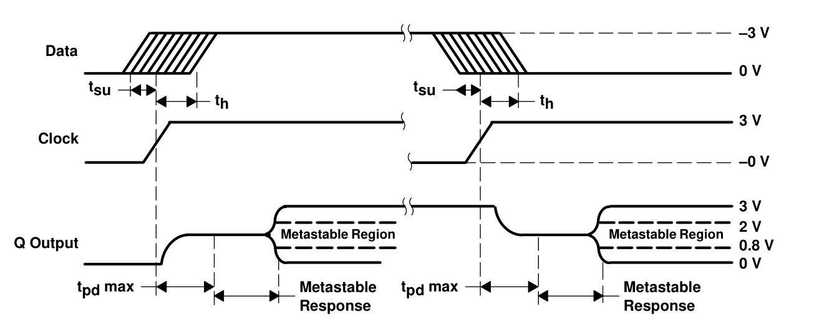

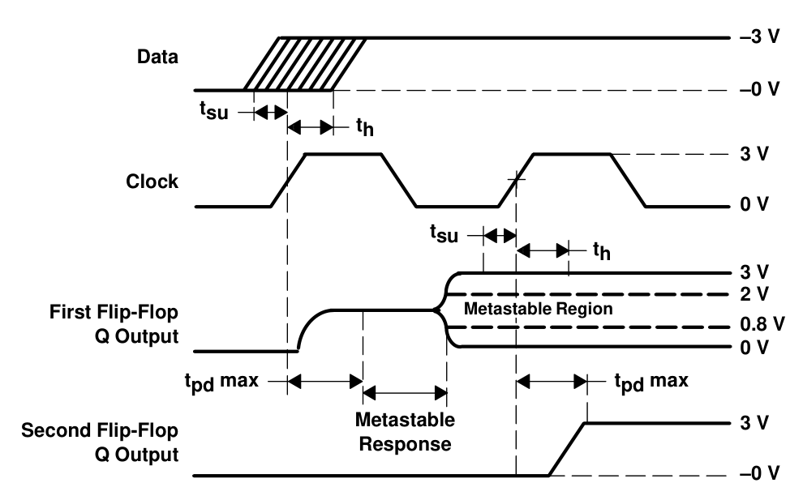

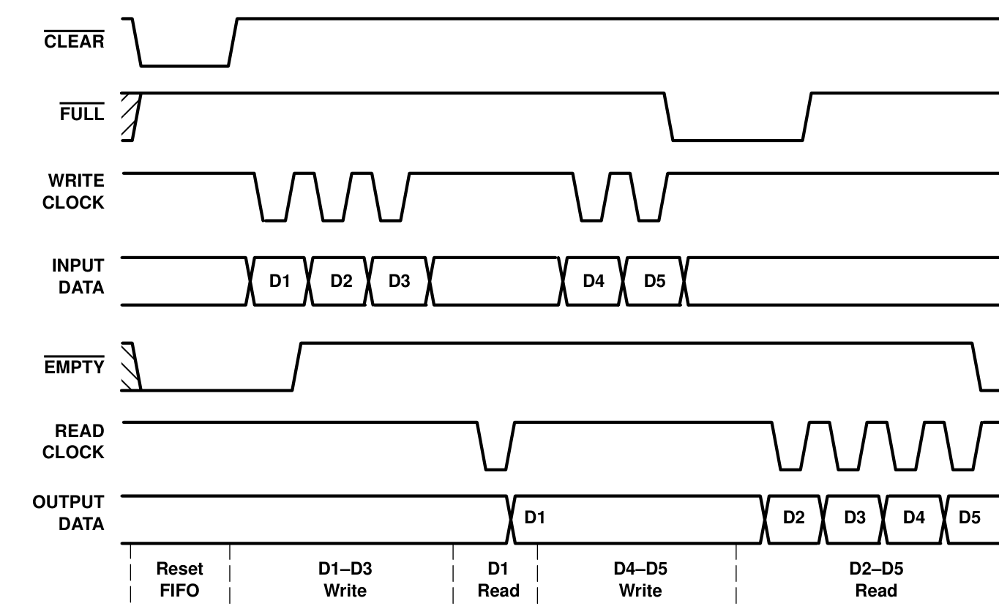

The asynchronous FIFO timing diagram illustrates reset, writes, reads, and FULL/EMPTY status in a depth-four example. This project uses a configurable FIFO depth.

## Basys 3 demonstration controls

The top-level wrapper generates a 100 MHz write clock and a 25 MHz read clock from the board's 100 MHz input using Clocking Wizard IP. The switch controls are synchronized into their destination domains.

| Basys 3 signal | Function |
|---|---|
| SW[15] | Asserts the FIFO reset when switched on |
| SW[14] | Each transition requests one write |
| SW[13] | Each transition requests one read |
| SW[12] | Selects the LED data view: last accepted read or next FIFO word |
| SW[11:0] | Write data switches; the wrapper uses the configured data width |
| LED[11:0] | Display data, with unused bits driven low |
| LED[12] | FIFO full |
| LED[13] | FIFO empty |
| LED[14] | Toggles after each accepted write |
| LED[15] | Toggles after each accepted read |

Set the data switches before toggling SW[14]. A change of the write or read request switch, in either direction, creates one request.

## Simulation

Open the Vivado project at vivado/parameterised_asynchronous_fifo.xpr. The testbench sources are in tb/. In Vivado, select a testbench as the simulation top and launch behavioral simulation. The default simulation set is configured for basys3_top_tb.

The ten testbenches cover the core FIFO, the Basys 3 wrapper, pointer movement, boundary flags, reset behavior, concurrent traffic, parameter combinations, stress traffic, and the synchronizer modules. Each source testbench is named for the behavior it exercises.

Three example waveform captures are shown below. Every PNG capture in waveforms/ has a same-named .wcfg file that can be opened in Vivado to restore the waveform signal layout.

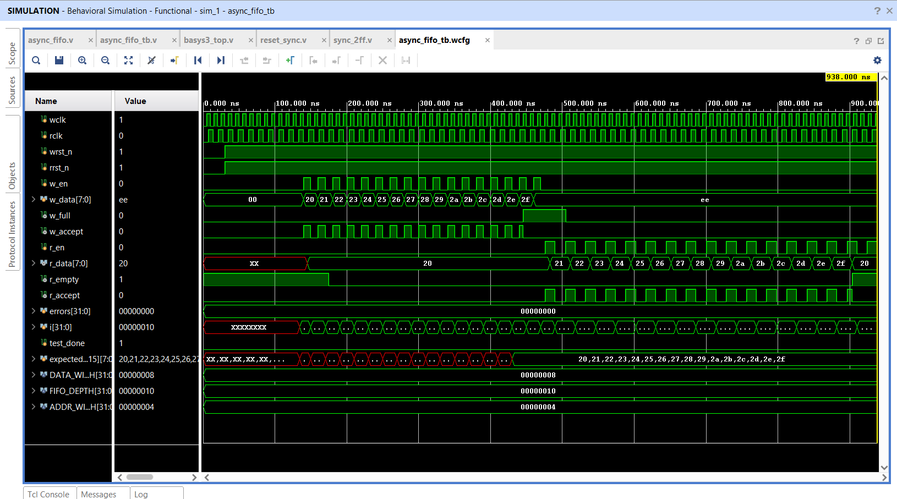

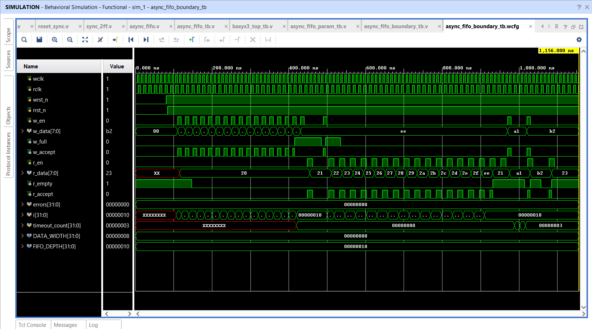

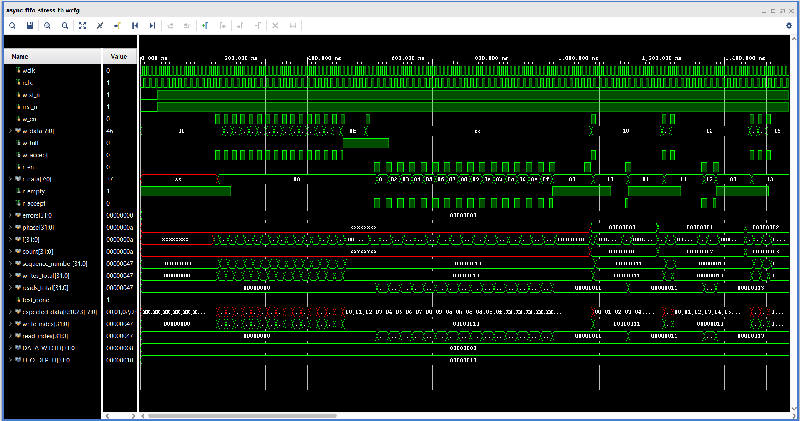

## Vivado project and scripts

The packaged XPR references the canonical files in rtl/, tb/, constraints/, and ip/ so the repository has only one maintained copy of each source. Generated runs and caches are not included. Vivado will create generated project data locally when the project is opened or built.

The project targets device xc7a35tcpg236-1 and identifies the Basys 3 board. Install the Basys 3 board files in Vivado if the board definition is not available in the local installation. The XPR does not contain a machine-specific board-store path.

- Open vivado/parameterised_asynchronous_fifo.xpr to inspect or build the packaged project.
- Run tcl_script/setup_fifo.tcl from the Vivado Tcl Console with the project open to configure the Clocking Wizard and launch synthesis.
- Run tcl_script/create_project.tcl from the Vivado Tcl Console to create a fresh project under build/vivado using the repository's canonical source folders. It stops if that output project already exists.

The project scripts target Vivado 2024.1. The existing reports and bitstream are saved artifacts from a previous run and may not match later source changes. Rebuild the project before relying on them for a new release.

## Bitstream

bitstream/basys3_top.bit is the included programming image for the Basys 3 design. It is a binary build artifact and is tracked intentionally because this repository includes the bitstream as a deliverable. The Vivado reports are provided as reference output; they should not be treated as a guarantee that a newly built design has the same results.

## Reports

The `reports/` folder contains 18 synthesis and implementation reports. In the saved routed timing summary, setup WNS is +6.587 ns, aggregate hold WHS is +0.049 ns, and there are zero reported setup or hold failures among 260 analyzed endpoints. The routed utilization snapshot uses 44 LUTs (0.21%), 104 registers (0.25%), 8 LUTs as distributed RAM, 0 block RAM tiles, and 0 DSPs. The power report estimates 0.183 W on-chip power; this is a tool estimate, not a board measurement. DRC reports zero violations and routing reports zero routing errors. Methodology reports 17 warnings: one reset-path warning and 16 missing LED output-delay warnings. The timing result covers only constrained paths, so it is not a complete board-level I/O timing sign-off. See [reports/README.md](reports/README.md) for the setup/hold values by clock domain, the pre-route versus routed hold comparison, detailed resource and power figures, warning meanings, and an explanation of each report.

## Visual asset guide

The architecture diagrams and selected timing figures are embedded above. The images/timing/ folder contains three figures extracted from the cited FIFO reference; images/vivado/ contains eight Vivado screenshots, and waveforms/ contains ten simulation PNGs plus ten matching waveform configuration files. See each asset folder README for a file-by-file description.

## File-by-file design guide

### RTL

| File | Purpose |
|---|---|
| rtl/async_fifo.v | Parameterised FIFO storage, binary and Gray pointers, accepted read/write operations, full/empty generation, and pointer crossings |
| rtl/basys3_top.v | Basys 3 wrapper, Clocking Wizard connections, switch synchronization and edge detection, FIFO control, and LED mapping |
| rtl/reset_sync.v | Asynchronous reset assertion with two-clock-edge synchronous release |
| rtl/sync_2ff.v | Configurable multi-stage synchronizer with optional asynchronous reset |

### Testbenches

| File | Coverage |
|---|---|
| tb/async_fifo_tb.v | Basic independent-clock FIFO write/read behavior |
| tb/async_fifo_boundary_tb.v | Empty/full boundary behavior and operation acceptance |
| tb/async_fifo_concurrent_tb.v | Concurrent writes and reads across independent clocks |
| tb/async_fifo_param_tb.v | Multiple legal width and depth configurations |
| tb/async_fifo_pointer_tb.v | Binary and Gray pointer progression and wrap behavior |
| tb/async_fifo_reset_tb.v | Reset behavior across the two FIFO clock domains |
| tb/async_fifo_stress_tb.v | Longer concurrent traffic and data-integrity checks |
| tb/basys3_top_tb.v | Clock-lock, reset release, switch-driven requests, and board wrapper behavior |
| tb/reset_sync_tb.v | Asynchronous assertion and synchronous reset release |
| tb/sync_2ff_tb.v | Synchronizer stage and reset configurations |

### Project, constraints, IP, and scripts

| File | Purpose |
|---|---|
| vivado/parameterised_asynchronous_fifo.xpr | Vivado project configured for the Basys 3 device and canonical repository paths |
| constraints/basys3_top.xdc | FPGA package pin assignments and clock timing constraints |
| ip/clk_wiz_0/clk_wiz_0.xci | Clocking Wizard configuration used to generate the 100 MHz and 25 MHz clocks |
| tcl_script/setup_fifo.tcl | Configures the top module and Clocking Wizard, updates compile order, and launches synthesis in an open project |
| tcl_script/create_project.tcl | Creates a fresh Vivado project from rtl/, tb/, constraints/, and ip/ under build/vivado |

### Build and visual assets

| File or group | Purpose |
|---|---|
| bitstream/basys3_top.bit | Previously generated Basys 3 programming image |
| reports/*.rpt | Synthesis and implementation report snapshots; each report is described in reports/README.md |
| images/architecture/*.png | Eight FIFO architecture and logic diagrams |
| images/timing/*.png | Three relevant FIFO and synchronization timing diagrams; see images/timing/README.md for descriptions and source pages |
| images/vivado/*.png | Eight Vivado design, clock, timing, and device screenshots |
| waveforms/*.png | Ten saved simulation waveform screenshots |
| waveforms/*.wcfg | Ten Vivado waveform layouts paired with the PNG captures |

## Reproducibility and license

Generated Vivado caches, run directories, logs, journals, checkpoints, and other temporary outputs are excluded by `.gitignore`. Keep the packaged XPR and canonical source inputs; Vivado can regenerate its local build outputs.

Original project source is licensed under the permissive CERN Open Hardware Licence Version 2 (`CERN-OHL-P-2.0`). The complete text is in [`LICENSE`](LICENSE), and [`NOTICE.md`](NOTICE.md) defines exactly which project-authored materials it covers. The license does not cover third-party or vendor-owned assets. In particular, the cropped Texas Instruments timing diagrams remain governed by TI’s reuse terms; source attribution does not grant redistribution permission. The Vivado screenshots, generated reports, waveform captures/configurations, and prebuilt bitstream are also outside the project license scope.