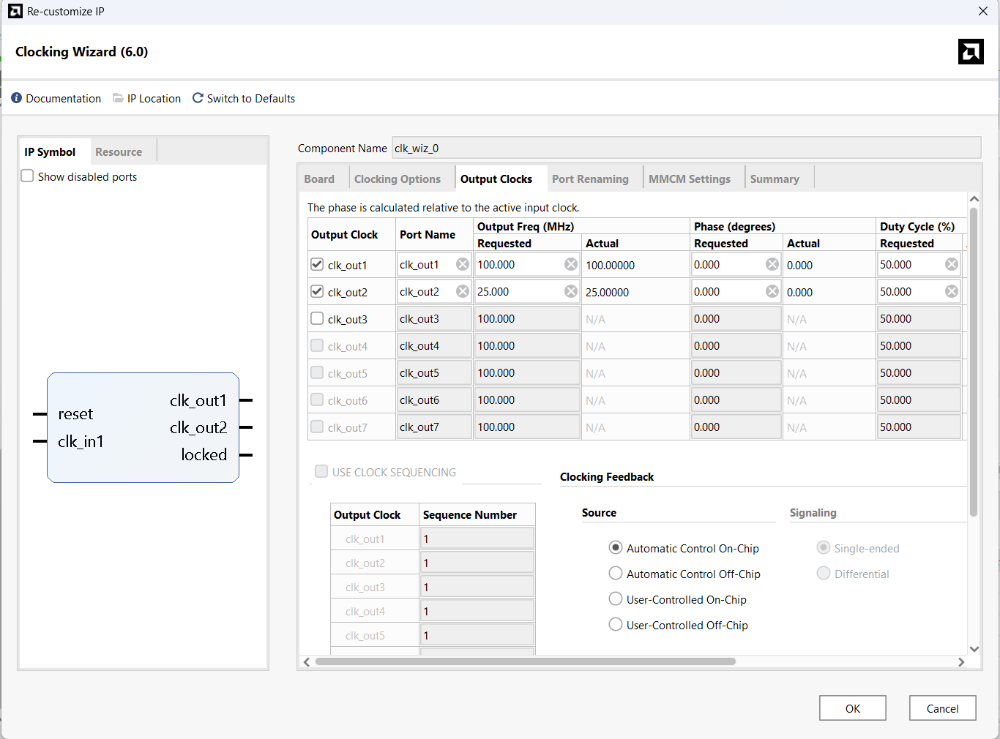
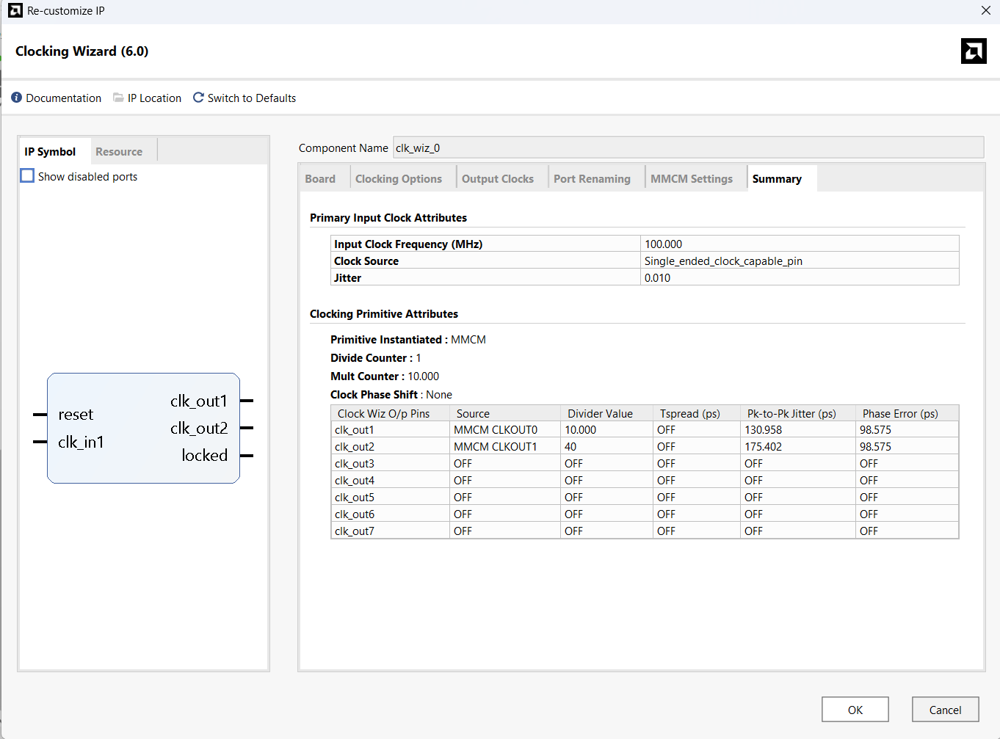
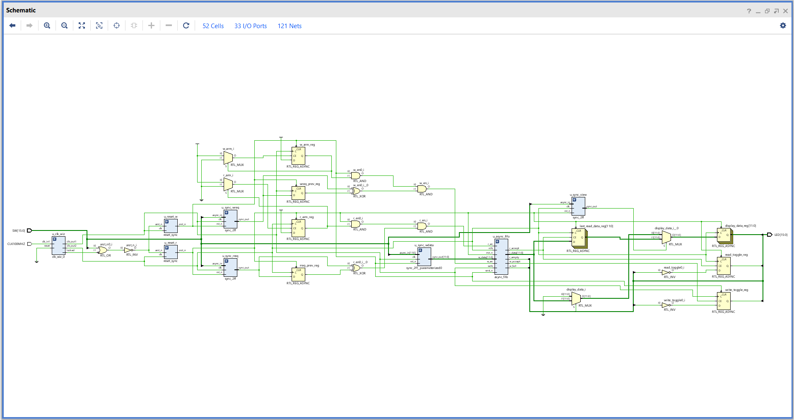
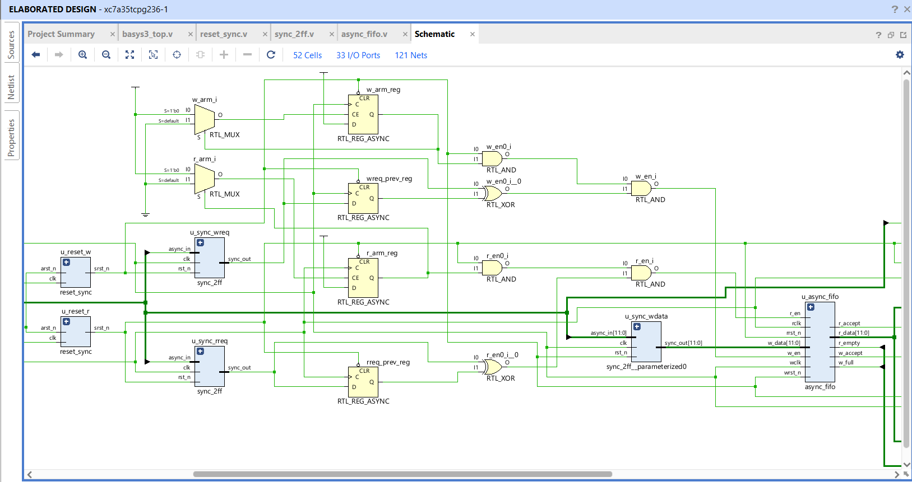
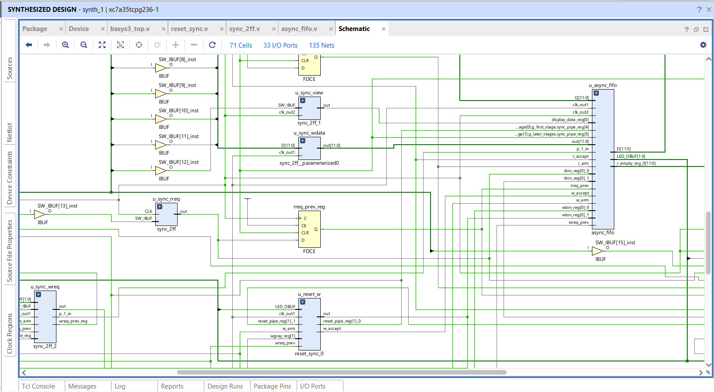
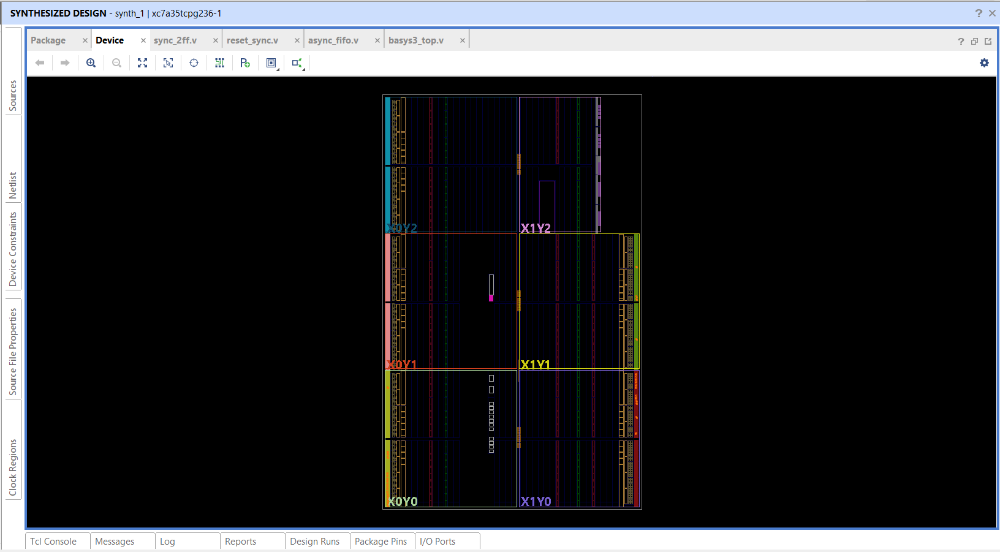
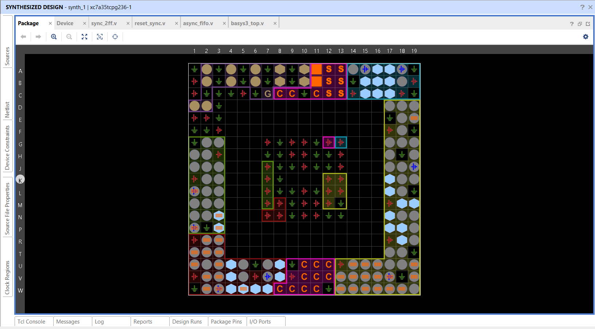
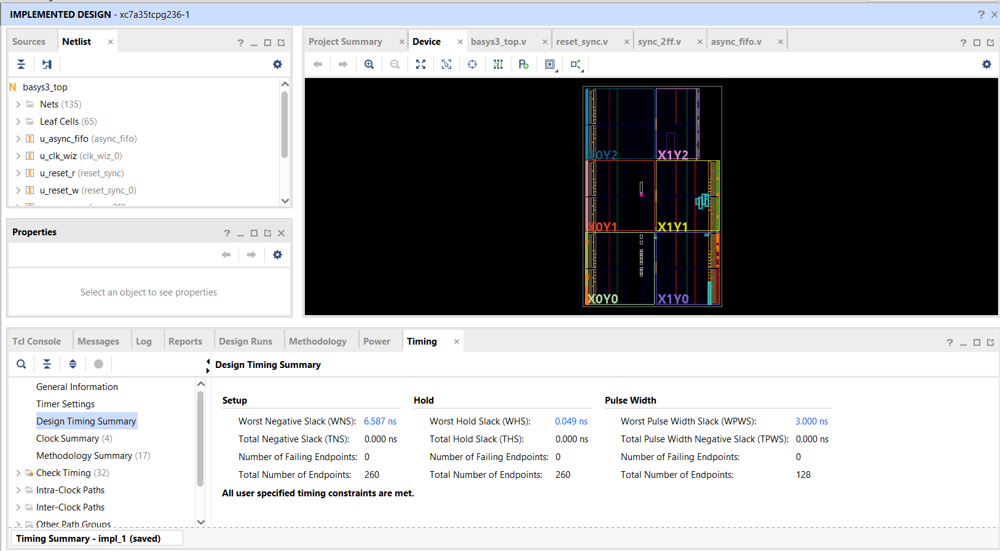

# Vivado screenshots

These eight static captures show distinct stages and views of the packaged Basys 3 project. They are saved user-interface images, not current outputs from the version of Vivado installed on a reader’s machine. Use the XPR and current source to reproduce the design view, and use `../reports/` for machine-readable report data.

## Clock generation

### Output-clock configuration

Shows the Clocking Wizard output-clock tab: `clk_out1` is requested at 100 MHz and `clk_out2` at 25 MHz, with 50% duty cycle.

### Clock Wizard summary

Shows the 100 MHz input and MMCM-derived output configuration summary. Compare against the committed `../../ip/clk_wiz_0/clk_wiz_0.xci` when checking project settings.

## Logic views

### Elaborated schematic, full view

Shows the overall elaborated top-level path from clock/reset and synchronized switch requests through the FIFO to the LED outputs.

### Elaborated schematic, zoomed view

A closer view of the elaborated reset, synchronizer, FIFO, and request logic. Elaboration expands RTL hierarchy into a schematic view; it is not the post-route physical implementation.

### Synthesized schematic

Shows the synthesized logic around the FIFO and wrapper. This is the mapped synthesis view, not a hand-drawn architecture diagram.

## FPGA views and implementation result

### Device placement view

Shows the synthesized design in the Artix-7 device grid. It is a placement-oriented tool view, not a pinout.

### Package pin view

Shows the package pin map and assigned I/O locations. Use the XDC and the board manufacturer’s pinout for actual pin assignments.

### Implemented timing summary

Shows the implementation timing summary panel with WNS, WHS, and pulse-width results. The detailed report interpretations and caveats are in `../../reports/README.md`.

## Provenance

All captures are saved Vivado views. Their run state can differ from a new build. The root README and `reports/README.md` identify the snapshot nature of the images and reports. These screenshots are outside the project source license; Xilinx/AMD software, UI, and marks remain subject to their owners’ terms.
