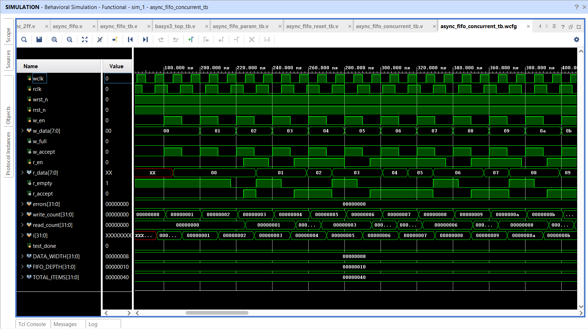
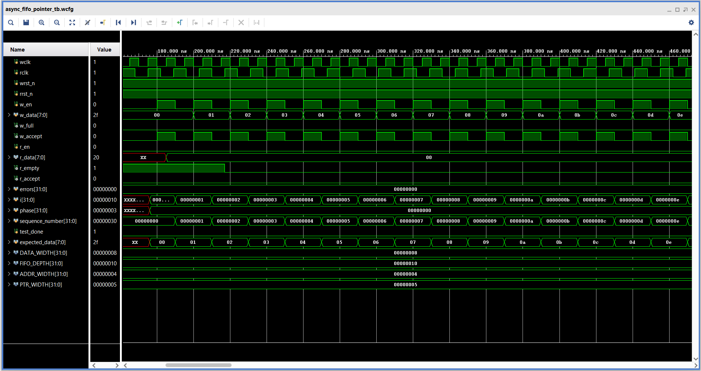
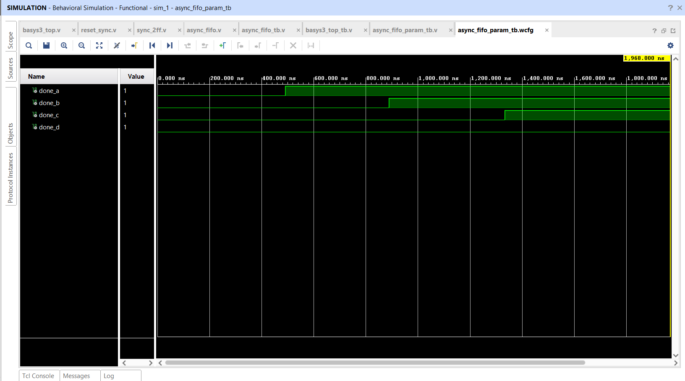
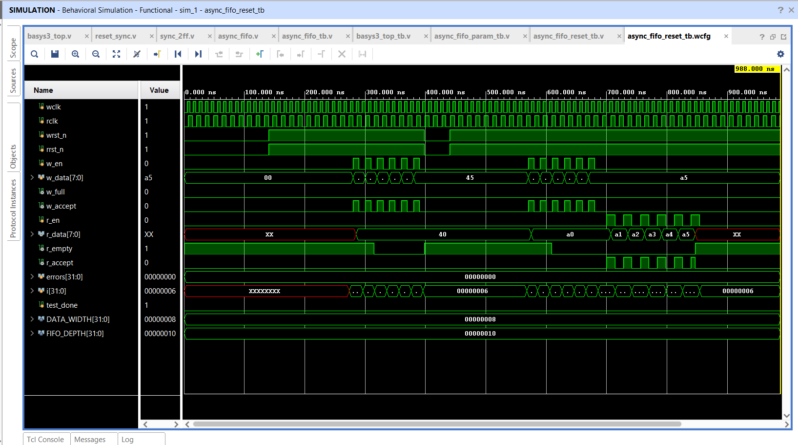
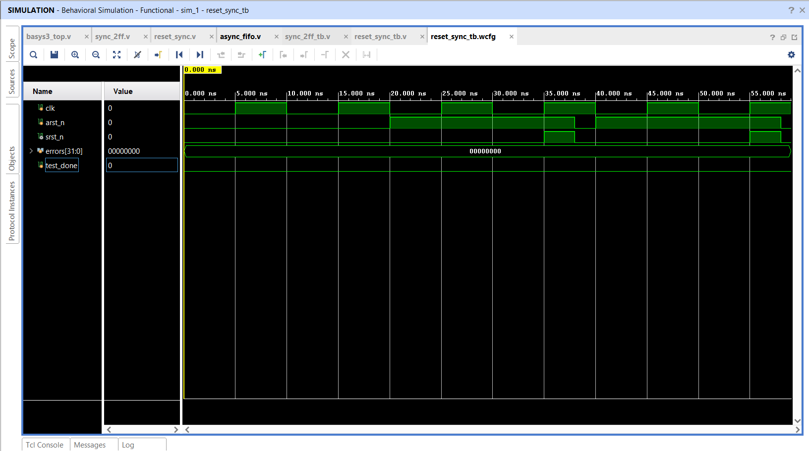
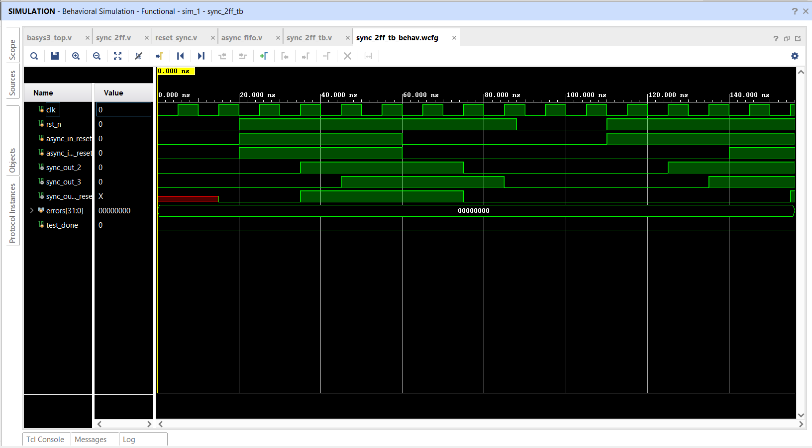
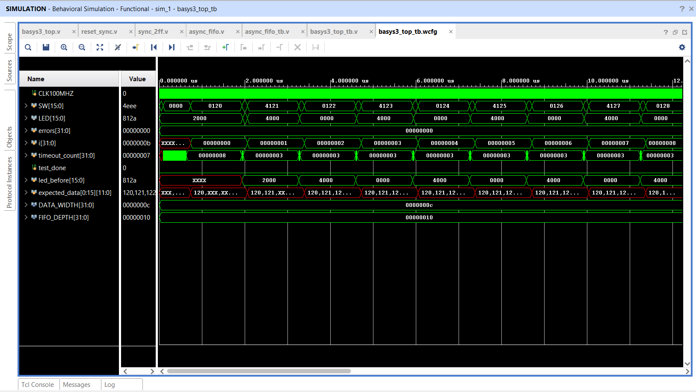

# Simulation waveform library

This folder contains ten saved Vivado waveform screenshots (`.png`) and ten matching waveform configuration files (`.wcfg`). Each pair uses the testbench name: the PNG shows a captured simulation view, while the WCFG stores signal selection, ordering, radix, and display configuration for a compatible simulation database.

A WCFG is a view configuration; it does not contain the design source or recreate simulation values by itself. Open a simulation run for the matching testbench, then load its WCFG. A screenshot can be read without Vivado, but it is a static capture and does not establish that the current source has passed a new simulation. See `../tb/README.md` for each testbench’s self-checking behavior.

## FIFO transaction and status views

### Basic FIFO transactions

`async_fifo_tb.png` / `async_fifo_tb.wcfg` show the baseline independent-clock FIFO test: reset, write/read activity, data, and status flags.

### Boundary and acceptance checks

`async_fifo_boundary_tb.png` / `async_fifo_boundary_tb.wcfg` show filling, full rejection, draining, empty rejection, and the simultaneous-operation phase.

### Concurrent producer and consumer

`async_fifo_concurrent_tb.png` / `async_fifo_concurrent_tb.wcfg` show concurrent write and read traffic under unrelated clock periods.

### Stress traffic

`async_fifo_stress_tb.png` / `async_fifo_stress_tb.wcfg` show repeated traffic phases from the longer data-integrity test.

### Pointer progression

`async_fifo_pointer_tb.png` / `async_fifo_pointer_tb.wcfg` show the pointer-focused test’s internal and interface activity around wraparound phases.

### Parameter configurations

`async_fifo_param_tb.png` / `async_fifo_param_tb.wcfg` show the completion signals for the four parallel width/depth configurations (8/4, 8/16, 12/16, and 16/32). Each completion signal indicates that its configuration checker reached its end; consult the simulator transcript for error counts and PASS status.

### Reset behavior

`async_fifo_reset_tb.png` / `async_fifo_reset_tb.wcfg` show the FIFO reset test across its two clock domains.

## Synchronizer and board wrapper views

### Reset synchronizer

`reset_sync_tb.png` / `reset_sync_tb.wcfg` show reset assertion and destination-clock release behavior.

### Two-flop synchronizer

`sync_2ff_tb.png` / `sync_2ff_tb.wcfg` show the configured synchronizer stages and input/output propagation.

### Basys 3 top-level wrapper

`basys3_top_tb.png` / `basys3_top_tb.wcfg` show the board wrapper’s clock lock, reset release, switch-driven operations, and LED status/data signals.

## Pairing and maintenance

The `.png` and `.wcfg` names intentionally match the ten testbench module names. If you replace a screenshot, capture it from the corresponding simulation and keep its configuration file paired with it. Do not present an old capture as the result of a newer RTL revision unless the simulation is rerun and the capture is refreshed.
